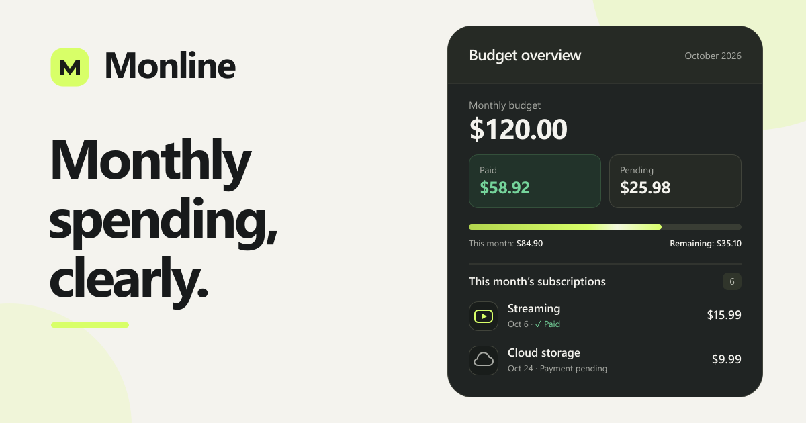

# Monline

 

**Monthly spending, clearly.**

A self-hosted home for your subscriptions, recurring payments, and budget. React frontend, Monline's own Node.js server and embedded SQLite storage.

**Mobile Responsive**

## Features

- **Subscription tracking** — automatic service logos, flexible billing cycles, active/inactive controls, and optional automatic renewal. Cards show their saved billing amount and period by default; a calendar icon switches each card between monthly and yearly equivalents.
- **Budget overview** — monthly charges, paid and outstanding amounts, and remaining budget.

- **Payment calendar** — see every payment on a day, mark payments as paid, and add historical payments individually or in a reviewed batch with editable amounts. Record independent payments with automatic or uploaded logos, categories, payers, and payment methods without creating a subscription. Move individual payments by dragging to another day, month, or year, or use the payment’s right-click menu to choose a date in another month. Future billing periods and actual payment details are preserved.

- **Payment-based insights** — selected-year paid totals and weekly/monthly averages calculated from recorded payment amounts. Upcoming recurring charges use the saved prices and schedules of subscriptions with automatic renewal enabled.
- **Yearly breakdowns** — January–December payment views and category breakdowns with paid/upcoming filters and independently expandable subscription details.
- **Statement import** — review online subscription charges from **Enpara**, **DenizBank**, and **Garanti BBVA** PDFs, including Amazon Prime and Google Workspace billing descriptors. Match or create subscriptions and import paid calendar entries without duplicates. Matching full-refund pairs within a statement are excluded together.
- **People, payment methods, and currencies** — choose defaults, recognize bank logos, convert currencies, and edit multiple payment methods or currencies together. Link a person to an existing Monline account by email and select that person when sharing a subscription. Existing people and payment history keep their IDs; linking an account or choosing a payer never grants access automatically. Full instance backups preserve account links, while portable account exports keep people as independent records without links to other accounts.
- **Complete backups** — account JSON import/export and administrator `.tar.gz` instance archives, including payment history, settings, logos, and attachments. Full instance exports require the administrator’s current account password. Restore a full instance backup directly from first setup, including archives from older versions.

- **Your language, your theme** — Turkish, English, German, Bulgarian and more, light/dark modes, and customizable accent colors.
- **Private accounts** — optional 30-day sign-in, two-factor authentication, trusted devices, OIDC sign-in, and scoped API keys.
- **Account administration** — the administrator’s Administration page lists registered users with search, account status, verification, security methods and active session counts. Create accounts, edit names and emails, set new passwords, manage verification, suspend or reactivate users, end sessions, or delete an account and its owned records. Suspended accounts cannot sign in or use existing sessions or API keys. The first registered administrator manages their own account through Profile and cannot be suspended or deleted through user management.
- **Groups and selective sharing** — create groups in Settings and use a subscription card’s Share button to grant view or edit access to selected groups, or view access to existing users by email. Subscriptions remain private until shared. Editors can update the subscription’s name, amount, billing cycle, frequency, next payment, renewal setting, active status, notes and URL. Only the owner can delete it or manage access and private account relations. Existing group shares keep view access until the owner upgrades them. The Share button turns green while the subscription is shared. Group management opens in a new tab so the sharing draft stays open. Shared items appear under “Shared with me” and stay separate from the recipient’s personal budget, calendar and statistics. Notes, URL and logo are shared; payment methods, household details, payment proofs and history remain private. Removing a group member or changing sharing permissions takes effect on subsequent requests; the shared list refreshes every 30 seconds or manually. When several grants apply, edit access takes precedence. Instance backups preserve groups and sharing; account and subscription exports omit access grants, and newly imported subscriptions start private.
- **Payment reminders** — the administrator configures global SMTP, delivery channels, destinations and reminder schedules under Administration → Channels. Each account chooses its own enabled channels independently in Settings → Notifications. Administrators can configure a channel while it is off, and saving delivery settings preserves each account’s existing preferences. The API prevents changing another account’s notification toggles; credentials and destinations stay hidden from regular users’ settings and API responses. Email templates follow the recipient account’s selected language.

## Local development

When running multiple local checkouts, give each API its own `MONLINE_PORT` and each Vite server its own frontend port. Start both processes with the same `MONLINE_PORT`; Vite uses it for `/api` requests. For example, in PowerShell set `$env:MONLINE_PORT = '8081'`, start `node apps/backend/src/server.cjs`, then in another terminal with the same variable run `node node_modules/vite/bin/vite.js --port 3000 --strictPort` from `apps/web`. The default API port is 8080. `MONLINE_API_URL` can override Vite's complete API target URL. This keeps logins and data connected to the intended checkout.

Before starting the local API, also set `$env:MONLINE_PUBLIC_URL = 'http://localhost:3000'` to point invitation, sharing and account email links at that local frontend. Without this override, emails use the public server URL stored in administration, which may point to another installation. The override does not change the saved administrator setting.

First-run setup fills the public server URL from the browser's current address. No installation hostname is built into the application. After moving or restoring an installation at a different address, update its public server URL in administration (or set `MONLINE_PUBLIC_URL` for that deployment).

People invitations and sharing invitations use the same consent. Sharing with a registered account that has not approved the sender creates a pending contact and pending access. Approval confirms the contact and activates the listed direct shares and group memberships together. Confirmed contacts can receive later shares immediately. Email confirmation pages show the requested subscriptions and permissions; removing a pending share cancels that access request.

The Share dialog can immediately pause access while keeping all recipients and permissions. Turning sharing back on restores the saved configuration. Deleting a person removes their direct shares, pending access requests and memberships in the sender's groups in the same database transaction. Group membership contains confirmed accounts only; unconfirmed addresses remain separate invitations until accepted. The group editor supports contact chips and selection from confirmed People.

The Share dialog lists only groups attached to that subscription. Other groups are available through Add group. A group's switch pauses its access while retaining its permissions; the trash button removes the association when saved. Removed groups stay available to add again but do not reappear as attached groups when reopening the dialog.

## Docker environment

Copy `.env.example` to `.env`. All variables are optional:

| Variable      | Default           | Purpose                                                   |
| ------------- | ----------------- | --------------------------------------------------------- |
| `PORT`        | `3000`            | Host port; the container listens on `3000`.               |
| `PUID`        | `1000`            | User ID running the server.                               |
| `PGID`        | `1000`            | Group ID running the server.                              |
| `TZ`          | `Europe/Istanbul` | Time zone for scheduled jobs.                             |
| `TRUST_PROXY` | `0`               | Set to `1` when one trusted reverse proxy fronts Monline. |

Run `docker compose up -d --build`, then open `http://localhost:3000`. On first launch, restore a full `.tar.gz` instance backup or start guided setup for the first administrator account, currency, budget, appearance and optional SMTP reminders. Restoring skips setup and returns to sign-in with the restored accounts. Existing installations keep their accounts and settings. New accounts start with the **Monline** accent color.

Data persists in `monline-volume`, mounted at `/data`. The database and uploaded assets live in `/data/monline`. Account JSON backups include attachments and personal notification toggles, while delivery configuration and exchange API settings remain managed by the administrator and are preserved in full instance backups. Import/Export provides the server administrator with single `.tar.gz` instance archives containing the SQLite database and all uploaded files for every user. Other users export their own accounts as JSON. Registration, limits and URLs, channels, API keys, exchange API settings, OIDC and maintenance controls live in Administration. Channel, exchange API and OIDC configuration are shared across the instance and managed only by administrators. Old settings links redirect to the corresponding Administration section. Restoring an instance replaces its data and signs everyone out; a complete safety backup is retained on the server before restoration. Legacy `.db` restores replace only the database. Instance restores accept archives up to 500 MiB (2 GiB expanded).

## Docker images

HTTP requests are limited per client IP and running instance: 600 requests per minute, 10 combined instance backup/restore requests per 15 minutes, and 20 account import requests per 15 minutes. Sign-in and verification retain their stricter limits. `/api/health` remains available independently of these limits.

Monline checks its official GitHub releases automatically. Newer stable versions appear in the sidebar with a release-notes link. Checks are cached for one hour. Install updates by pulling the new Docker image and recreating the container.

GitHub Actions publishes the same **AMD64 and ARM64** image to both registries:

| Registry | Image |
| -------- | ----- |
| GitHub Container Registry (GHCR) | `ghcr.io/caglaryalcin/monline` |
| Docker Hub | `caglaryalcin/monline` |

| Trigger | Image tags |
| ------- | ---------- |
| Release tag, e.g. `v1.5.0` | `v1.5.0`, `1.5.0`, `1.5`, `1`, `latest` |

Images are published for version tags or by manually running the Docker Publish workflow for an existing release tag; pushes to `main` do not publish images. Release tags must match the root, frontend and server package versions. Prereleases publish only their full version tags and leave `latest` unchanged.

For prebuilt deployment, use `image: ghcr.io/caglaryalcin/monline:1.5.0` or `image: caglaryalcin/monline:1.5.0`, omit `build`, and run `docker compose up -d`.

## Upgrading from v1.4.0 to v1.5.0

Export a full instance backup before upgrading, retain the existing `/data` volume and environment, then pull image `1.5.0` and recreate the container. Source installations can use `docker compose up -d --build`. Startup automatically adds the optional currency-code preference; existing accounts keep the previous price display until they enable **Settings → Theme and appearance → Display options → Show currency codes**. Both subscription layouts and shared subscriptions support it, including converted and original prices.

Administration → Channels now combines SMTP configuration, editable payment/cancellation message templates and previews. Templates are saved separately for each language; reminders follow each recipient's saved profile language and use built-in translations when no custom template exists. Template previews do not send messages; the Test button sends the selected reminder type using the current draft.

Administrators manage their personal channel switches inside Administration → Channels. Their old Settings → Notifications links redirect there; regular users retain their personal Notifications page. Global channel configuration and each account's enabled channels remain separate. Existing notification preferences, subscriptions, sharing permissions and login sessions are preserved.

## Upgrading from v1.3.0 to v1.4.0

Export a full instance `.tar.gz` backup from v1.3.0 before upgrading. Keep the existing `/data` volume and deployment environment; update the image to `1.4.0`, pull it and recreate the container. Source-based installations should rebuild with `docker compose up -d --build`. Do not remove the volume. Startup adds the new database fields and sharing tables automatically; subscriptions start private and existing payments, statements, passwords, API keys and login sessions remain in place. Restoring a full backup intentionally signs everyone out.

The existing first administrator remains the administrator. Their saved notification channel credentials, destinations, reminder schedule and exchange API settings become the instance-wide configuration. Other accounts retain their own channel switches; their former personal delivery configuration does not replace the administrator's global settings. Review Administration → Channels and API after upgrading, especially if those integrations were previously configured only on another account. SMTP and OIDC settings retain their existing instance-wide configuration. Email reminders use each account's registered email address.

The generated `Me` person is linked to its own account and renamed to the account's display name while retaining its ID and historical payer references. Custom People names and existing default selections are preserved. Other old People records remain available in history, but require an email invitation and approval before becoming selectable as confirmed payers or active group members. Upgrading does not send invitations automatically.

Verify the public server URL in Administration before sending invitations. Leave `MONLINE_PUBLIC_URL` empty unless intentionally overriding that URL for this deployment. Existing v1.3.0 full instance archives can be restored directly into v1.4.0. For a rollback, retain both the v1.3.0 image and its pre-upgrade backup.

## Contributors

Special thanks to [@mariushosting](https://github.com/mariushosting) for creating the [Monline installation guide for Synology NAS](https://mariushosting.com/how-to-install-monline-on-your-synology-nas/) and contributing to the fix released in v1.2.1.

Special thanks to [@macitozcan](https://github.com/macitozcan) for reviewing Monline and reporting the billing schedule, cost calculation, backup restore, iCalendar, and external API issues addressed in v1.0.14.

## License

Monline is licensed under the GNU General Public License v3.0 (`GPL-3.0-only`). See [LICENSE](LICENSE).
