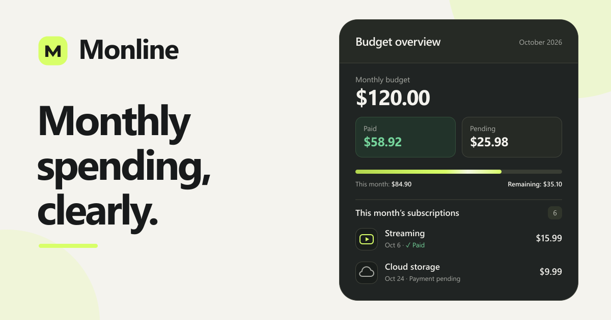
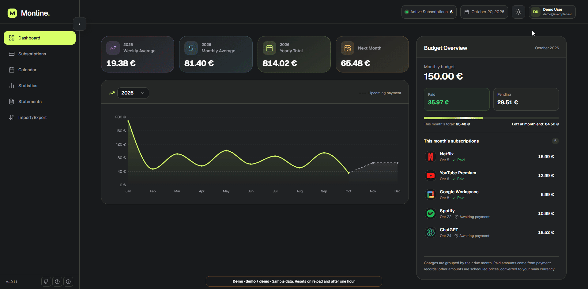
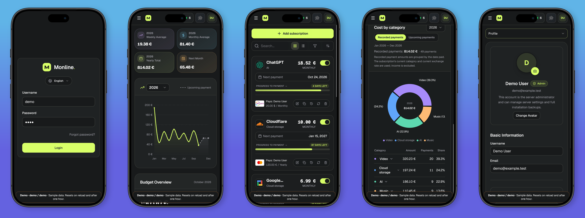
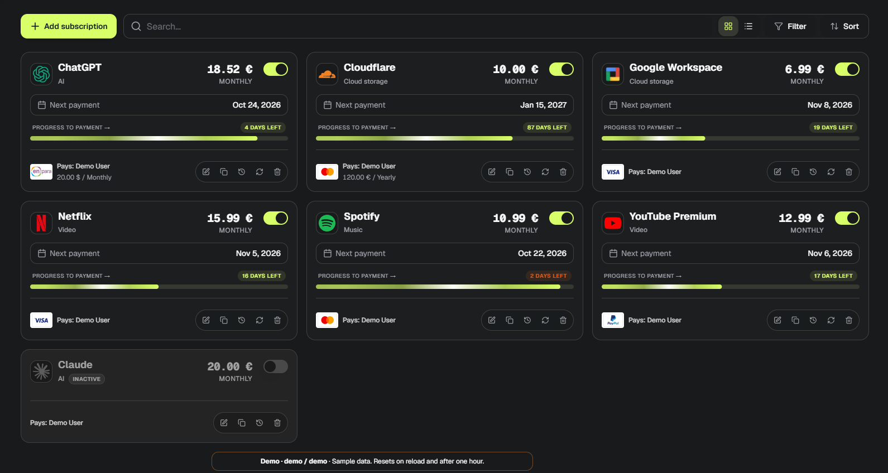
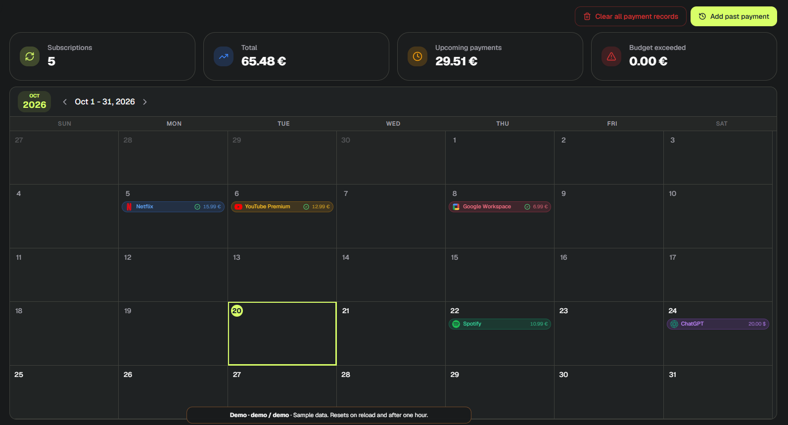
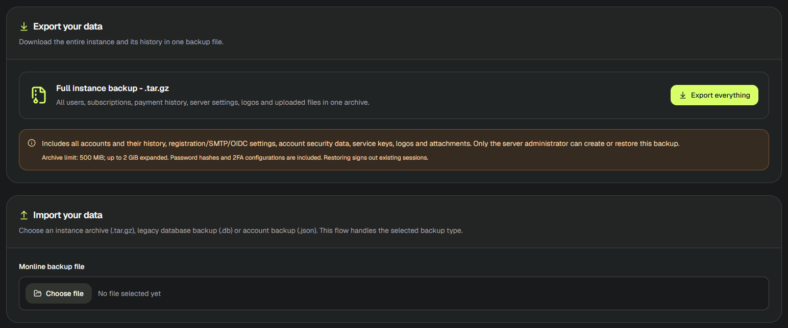

# Monline

 [](https://github.com/caglaryalcin/monline/releases)

**Monthly spending, clearly.**

A self-hosted home for your subscriptions, recurring payments, and budget. React frontend, Monline's own Node.js server and embedded SQLite storage.



**Mobile Responsive**


## Features

- **Finance workspace** - Overview, Income & expenses, Debts and Savings share one navigation bar. Bank statements live within Debts alongside Installments and Loans; the sidebar provides Dashboard, Finance, Subscriptions, Calendar and Reports. Finance Overview reuses the ledger's monthly calculation, including its carried deficit. Assets show three totals: savings, debts and net assets. Debts combine unpaid entries assigned to the current month with each card's latest linked statement balance after subsequent recorded payments. A card's scheduled repayment and its statement balance count once, using the larger recorded amount. Future-month payment plans and future installments stay outside this total. Net assets equal savings minus these debts. Dashboard remains a separate page with payment tracking, yearly analysis and budget overview. Existing page URLs still work; Finance Overview opens at `/finance/overview`.
- **Subscription tracking** - automatic service logos, flexible billing cycles, active/inactive controls, and optional automatic renewal. Cards show their saved billing amount and period by default; a calendar icon switches each card between monthly and yearly equivalents.
- **Holiday preferences** - choose your country and region in Profile → Preferences. Last-business-day subscriptions skip Saturdays, Sundays and the selected calendar’s public/bank holidays, including partial-day closures. No country means weekends only. Holiday rules run locally using [date-holidays](https://github.com/commenthol/date-holidays); keep the application updated for calendar changes. Saved paid and past payments retain their dates.
- **Budget overview** - choose monthly, 3-month, 6-month or 1-year views of actual payment amounts. The range starts in the current month. The configured monthly budget is multiplied by the number of months; subscription billing schedules and recorded payments stay unchanged.
- **Savings** - record Turkish lira, US dollars, euros, British pounds, other currencies quoted by Fixer, gram gold and quarter, half, full or Republic gold coins. Each holding keeps its original currency and quantity, with that currency's decimal precision. All quotes use the installation's existing Fixer connection and API key. Choose TRY, USD, EUR or another supported display currency for holdings, category totals, the combined portfolio and form previews; TRY holdings valued in TRY need no exchange rate. Additional held currencies have their own summary cards, with total savings at the right. Gold uses Fixer's XAU troy-ounce reference rate: gram gold represents 24-karat fine gold; ziynet quarter/half/full coins use 1.754/3.508/7.016 g at 22 karat and Republic/Ata coins use 7.216 g at 22 karat. These are estimated intrinsic metal values, excluding retail premiums, workmanship and spreads. Public quotes are shared with the normal exchange service and cached for 12 hours; Refresh rates requests an update. Source timestamps and unavailable or older rates are shown explicitly. Savings are private to each account and included in account exports and instance backups.
- **Scheduled subscription prices** - enter a new price and a future effective date in the subscription form. The initial price applies until that date, and payments due on or after it use the new price. Plan several changes ahead, edit or cancel future changes, and see the next change on the subscription card. Changes already in effect are retained in the price history. Recorded past and paid payments keep their saved amounts; manually overridden or moved upcoming payments retain their amounts too. Price schedules are included in subscription exports and account/instance backups.



- **Quick payment confirmation** - mark manual subscription payments as paid directly from the dashboard or subscription card, with a confirmation showing the amount and due date. The button appears two days before the due date and remains available for overdue payments while payment tracking is enabled. Existing payment details and past history are preserved; repeated confirmation does not create a duplicate.
- **Payment calendar** - see every payment on a day, mark payments as paid, and add historical payments individually or in a reviewed batch with editable amounts. Record independent payments with automatic or uploaded logos, categories, payers, and payment methods without creating a subscription. Move individual payments by dragging to another day, month, or year, or use the payment’s right-click menu to choose a date in another month. Future billing periods and actual payment details are preserved.



- **Payment-based insights** - selected-year paid totals and weekly/monthly averages calculated from recorded payment amounts. Upcoming recurring charges use the saved prices and schedules of subscriptions with automatic renewal enabled.
- **Yearly breakdowns** - January–December payment views and category breakdowns with paid/upcoming filters and independently expandable subscription details.
- **Statement import** - review online subscription charges from **Enpara**, **DenizBank**, and **Garanti BBVA** PDFs, including Amazon Prime and Google Workspace billing descriptors. Match or create subscriptions and import paid calendar entries without duplicates. Matching full-refund pairs within a statement are excluded together.
- **People, payment methods, and currencies** - choose defaults, recognize bank logos, convert currencies, and edit multiple payment methods or currencies together. Link a person to an existing Monline account by email and select that person when sharing a subscription. Existing people and payment history keep their IDs; linking an account or choosing a payer never grants access automatically. Full instance backups preserve account links, while portable account exports keep people as independent records without links to other accounts.
- **Page-specific transfers** - subscription exports preserve plans, history, related categories/currencies/people/payment methods and logos. Calendar exports preserve recorded paid/pending payments, moved due dates, inherited branding and attachments. Import subscriptions before calendar records to retain their links; otherwise payments are restored independently. Reimporting skips existing records and preserves local changes. Incomplete attachments or unsupported account datasets are rejected before import. The Debt/Installments transfer includes finite subscription plans and complete source statements; card links, calendar payment records, the income/expense ledger and loans stay outside that transfer. Use a full backup to preserve the complete installation.
- **Complete backups** - account JSON import/export and administrator `.tar.gz` instance archives, including payment history, settings, logos, and attachments. Full instance exports require the administrator’s current account password. Restore a full instance backup directly from first setup, including archives from older versions.



- **Your language, your theme** - Turkish, English, German, Bulgarian and more, light/dark modes, and customizable accent colors.
- **Private accounts** - optional 30-day sign-in, two-factor authentication, trusted devices, OIDC sign-in, and scoped API keys.
- **Account administration** - the administrator’s Administration page lists registered users with search, account status, verification, security methods and active session counts. Create accounts, edit names and emails, set new passwords, manage verification, suspend or reactivate users, end sessions, or delete an account and its owned records. Suspended accounts cannot sign in or use existing sessions or API keys. The first registered administrator manages their own account through Profile and cannot be suspended or deleted through user management.
- **Groups and selective sharing** - create groups in Settings and use a subscription card’s Share button to grant view or edit access to selected groups, or view access to existing users by email. Subscriptions remain private until shared. Editors can update the subscription’s name, amount, billing cycle, frequency, next payment, renewal setting, active status, notes and URL. Only the owner can delete it or manage access and private account relations. Existing group shares keep view access until the owner upgrades them. The Share button turns green while the subscription is shared. Group management opens in a new tab so the sharing draft stays open. Shared items appear under “Shared with me” and stay separate from the recipient’s personal budget, calendar and statistics. Notes, URL and logo are shared; payment methods, household details, payment proofs and history remain private. Removing a group member or changing sharing permissions takes effect on subsequent requests; the shared list refreshes every 30 seconds or manually. When several grants apply, edit access takes precedence. Instance backups preserve groups and sharing; account and subscription exports omit access grants, and newly imported subscriptions start private.
- **Payment reminders** - administrators configure shared SMTP, channel connections and notification templates in Administration → Channels. Users enable configured channels for their account and choose their own default reminder schedule in Settings → Notifications. Subscriptions can override that account’s schedule.

## Local development

When running multiple local checkouts, give each API its own `MONLINE_PORT` and each Vite server its own frontend port. Start both processes with the same `MONLINE_PORT`; Vite uses it for `/api` requests. For example, in PowerShell set `$env:MONLINE_PORT = '8081'`, start `node apps/backend/src/server.cjs`, then in another terminal with the same variable run `node node_modules/vite/bin/vite.js --port 3000 --strictPort` from `apps/web`. The default API port is 8080. `MONLINE_API_URL` can override Vite's complete API target URL. This keeps logins and data connected to the intended checkout.

Before starting the local API, also set `$env:MONLINE_PUBLIC_URL = 'http://localhost:3000'` to point invitation, sharing and account email links at that local frontend. Without this override, emails use the public server URL stored in administration, which may point to another installation. The override does not change the saved administrator setting.

First-run setup fills the public server URL from the browser's current address. No installation hostname is built into the application. After moving or restoring an installation at a different address, update its public server URL in administration (or set `MONLINE_PUBLIC_URL` for that deployment).

People invitations and sharing invitations use the same consent. Sharing with a registered account that has not approved the sender creates a pending contact and pending access. Approval confirms the contact and activates the listed direct shares and group memberships together. Confirmed contacts can receive later shares immediately. Email confirmation pages show the requested subscriptions and permissions; removing a pending share cancels that access request.

The Share dialog can immediately pause access while keeping all recipients and permissions. Turning sharing back on restores the saved configuration. Deleting a person removes their direct shares, pending access requests and memberships in the sender's groups in the same database transaction. Group membership contains confirmed accounts only; unconfirmed addresses remain separate invitations until accepted. The group editor supports contact chips and selection from confirmed People.

The Share dialog lists only groups attached to that subscription. Other groups are available through Add group. A group's switch pauses its access while retaining its permissions; the trash button removes the association when saved. Removed groups stay available to add again but do not reappear as attached groups when reopening the dialog.

## Docker environment

Copy `.env.example` to `.env`. All variables are optional:

| Variable      | Default           | Purpose                                                   |
| ------------- | ----------------- | --------------------------------------------------------- |
| `PORT`        | `3000`            | Host port; the container listens on `3000`.               |
| `PUID`        | `1000`            | User ID running the server.                               |
| `PGID`        | `1000`            | Group ID running the server.                              |
| `TZ`          | `Europe/Istanbul` | Time zone for scheduled jobs.                             |
| `TRUST_PROXY` | `0`               | Set to `1` when one trusted reverse proxy fronts Monline. |

Run `docker compose up -d --build`, then open `http://localhost:3000`. On first launch, restore a full `.tar.gz` instance backup or start guided setup for the first administrator account, currency, budget, appearance and optional SMTP reminders. Restoring skips setup and returns to sign-in with the restored accounts. Existing installations keep their accounts and settings. New accounts start with the **Monline** accent color.

Data persists in `monline-volume`, mounted at `/data`. The database and uploaded assets live in `/data/monline`. Account JSON backups include attachments and personal notification toggles and reminder schedules, while delivery configuration and exchange API settings remain managed by the administrator and are preserved in full instance backups. Import/Export provides the server administrator with single `.tar.gz` instance archives containing the SQLite database and all uploaded files for every user. Other users export their own accounts as JSON. Registration, limits and URLs, channels, API keys, exchange API settings, OIDC and maintenance controls live in Administration. Channel, exchange API and OIDC configuration are shared across the instance and managed only by administrators. Old settings links redirect to the corresponding Administration section. Restoring an instance replaces its data and signs everyone out; a complete safety backup is retained on the server before restoration. Legacy `.db` restores replace only the database. Instance restores accept archives up to 500 MiB (2 GiB expanded).

## Docker images

HTTP requests are limited per client IP and running instance: 600 requests per minute, 10 combined instance backup/restore requests per 15 minutes, and 20 account import requests per 15 minutes. Sign-in and verification retain their stricter limits. `/api/health` remains available independently of these limits.

Monline checks its official GitHub releases automatically. Newer stable versions appear in the sidebar with a release-notes link. Checks are cached for one hour. Install updates by pulling the new Docker image and recreating the container.

GitHub Actions publishes the same **AMD64 and ARM64** image to both registries:

| Registry | Image |
| -------- | ----- |
| GitHub Container Registry (GHCR) | `ghcr.io/caglaryalcin/monline` |
| Docker Hub | `caglaryalcin/monline` |

| Trigger | Image tags |
| ------- | ---------- |
| Release tag, e.g. `v1.5.0` | `v1.5.0`, `1.5.0`, `1.5`, `1`, `latest` |

Images are published for version tags or by manually running the Docker Publish workflow for an existing release tag; pushes to `main` do not publish images. Release tags must match the root, frontend and server package versions. Prereleases publish only their full version tags and leave `latest` unchanged.

For prebuilt deployment, use `image: ghcr.io/caglaryalcin/monline:1.5.0` or `image: caglaryalcin/monline:1.5.0`, omit `build`, and run `docker compose up -d`.

## Upgrading from v1.4.0 to v1.5.0

Export a full instance backup before upgrading, retain the existing `/data` volume and environment, then pull image `1.5.0` and recreate the container. Source installations can use `docker compose up -d --build`. Startup automatically adds the optional currency-code preference; existing accounts keep the previous price display until they enable **Settings → Theme and appearance → Display options → Show currency codes**. Both subscription layouts and shared subscriptions support it, including converted and original prices.

Settings → Notifications contains personal channel switches and reminder times. Administrators manage shared connections, SMTP, templates and previews in Administration → Channels. Templates are saved by language.

All accounts, including administrators, manage their personal switches and reminder schedule in Settings → Notifications. Shared channel configuration is separate from each account’s preferences.

## Upgrading from v1.3.0 to v1.4.0

Export a full instance `.tar.gz` backup from v1.3.0 before upgrading. Keep the existing `/data` volume and deployment environment; update the image to `1.4.0`, pull it and recreate the container. Source-based installations should rebuild with `docker compose up -d --build`. Do not remove the volume. Startup adds the new database fields and sharing tables automatically; subscriptions start private and existing payments, statements, passwords, API keys and login sessions remain in place. Restoring a full backup intentionally signs everyone out.

The existing administrator continues managing shared SMTP and channel credentials. Each account retains its own channel switches and default reminder schedule. Notification emails go to the recipient account’s registered address.

The generated `Me` person is linked to its own account and renamed to the account's display name while retaining its ID and historical payer references. Custom People names and existing default selections are preserved. Other old People records remain available in history, but require an email invitation and approval before becoming selectable as confirmed payers or active group members. Upgrading does not send invitations automatically.

Verify the public server URL in Administration before sending invitations. Leave `MONLINE_PUBLIC_URL` empty unless intentionally overriding that URL for this deployment. Existing v1.3.0 full instance archives can be restored directly into v1.4.0. For a rollback, retain both the v1.3.0 image and its pre-upgrade backup.

## Scheduled Excel exports (beta)

Settings → Import/Export → Scheduled Excel exports has separate NAS and Google
Drive destinations. Each has its own hourly, 6-hourly, 12-hourly, daily or weekly
schedule, a Send now button, the last successful export and the next run.
Schedules are stored on the server and run with the browser closed. An overdue
export runs after the server comes back online. Failed exports retry after
15 minutes; an expired Google authorization pauses that destination until it
is reconnected and enabled again.

Both destinations use the same workbook as the manual Excel download, including
its formulas and charts. Saving a schedule selects the current interface
language and theme for future exports. Each destination replaces one file
instead of accumulating dated copies. These spreadsheets contain the current
account's financial data; they are separate from full instance backups.

### NAS

Select **Configure → SMB / Windows share** to send directly to a NAS without
mounting its share into the container. Enter the NAS IP address or hostname,
share name, optional existing subfolder, username, password and optional
domain/workgroup. The server must be able to reach the NAS on TCP port 445;
enable SMB2/SMB3 and grant that user write access to the destination.
Save the configuration, then use **Test connection** to check access without
sending a file. **Send now** writes the workbook immediately.

SMB exports write `Monline.xlsx` directly inside the selected share/folder.
Exports using the same destination replace that same file. NAS exports are
serialized so concurrent requests cannot overwrite an in-progress upload.
A temporary upload is renamed over the existing file after transfer. The NAS
password is encrypted in private server metadata and is never returned by the
configuration API. Docker images include Samba's `smbclient`; Linux/macOS source
installations must provide that executable in PATH. On Windows source
installations, Monline uses the native SMB client through a temporary
credentialed PowerShell drive, without saving a persistent drive mapping.
The connection check confirms that the folder is reachable; an actual export
also requires write and replacement permissions.

To keep using a directory already mounted on the server, select
**Mounted server folder** instead. For Docker:

Mount a writable NAS directory on the Docker host first. Add a bind mount in
`docker-compose.override.yml`, for example:

```yaml
services:
  app:
    volumes:
      - type: bind
        source: /mnt/nas/monline
        target: /exports
        bind:
          create_host_path: false
```

In Settings → Import/Export → NAS → Configure, save `/exports` as the NAS
folder. No restart is needed when saving through the interface.
Alternatively set `MONLINE_EXPORT_DIR=/exports` in `.env` and recreate the
container; an environment override makes that field read-only in the interface.
The mount must exist and be writable by the configured `PUID`/`PGID`.
Monline writes `Monline.xlsx` directly under that directory and replaces
it atomically. A missing mount or failed write is reported in the account's
export status. For a source installation, set `MONLINE_EXPORT_DIR` to an
existing local or mounted directory visible to the server process.

### Google Drive

Google Drive is currently marked **Coming soon**. Its configuration, connection,
schedule and export controls are disabled, and the server does not run Drive
exports. The setup details below are retained for a future release.

**Connect Google Drive** uses Google's account selection and consent screen.
This is OAuth authorization, not an API key entered by each user. Uploading the
file still uses Google Drive API. The administrator performs the OAuth client
setup below once for the installation; ordinary users only connect their
Google accounts. Monline currently has no centrally hosted OAuth broker or
preconfigured shared Google OAuth client.

1. Enable Google Drive API in a Google Cloud project and configure its OAuth
   consent screen. Create an OAuth client of type **Web application**.
2. In Settings → Import/Export → Google Drive → Configure, save the client ID
   and client secret. The saved secret is not returned to the browser; leave its
   field empty to keep the existing value when editing.
3. Check the installation's public **Server URL** in that configuration window
   or in Administration.
   `MONLINE_PUBLIC_URL`, if set, overrides it. Stable and beta need their
   respective public URLs.
4. Register the exact Google OAuth redirect URI shown in Settings →
   Import/Export. It ends in `/api/spreadsheet-schedules/drive/callback`.
   Use HTTPS for a public installation; localhost is supported for development.
5. Select **Connect Google Drive**, grant access, then save the desired schedule.

Administrators configure shared destinations; each account connects its own
Drive and manages its own schedule. The interface changes take effect
immediately. Existing `MONLINE_GOOGLE_CLIENT_ID` and
`MONLINE_GOOGLE_CLIENT_SECRET` environment overrides remain supported and make
their fields read-only. Change overrides in deployment settings and restart the
server. Changing a saved Google client ID or secret disconnects existing Drive
connections and pauses their schedules until accounts reconnect and enable them.
The small information buttons beside Excel, scheduling and destination headings
contain the detailed explanations and setup instructions.

Monline requests only Google's `drive.file` scope and offline access. It creates
`Monline.xlsx` in the connected Drive, remembers its file ID and updates that
same file on later exports. Moving the file into another Drive folder does not
break the schedule. Disconnect revokes access and pauses Drive exports; it
leaves the exported file in Drive. Google OAuth tokens and export settings are
private server metadata, excluded from account JSON and Excel exports.

See Google's [web-server OAuth guide](https://developers.google.com/identity/protocols/oauth2/web-server)
and [Drive scopes guide](https://developers.google.com/workspace/drive/api/guides/api-specific-auth)
for OAuth consent, publishing and access requirements. An external OAuth app
left in Google's Testing mode can require reconnecting after its refresh token
expires; use an appropriate production configuration for unattended schedules.

### Statement privacy and public URL

Statement PDFs and their passwords are processed in the browser. Saving a
statement sends its extracted transactions, summary, filename, page count and
file hash to the server. The original PDF and password are not uploaded.

The public Server URL is used in generated account emails, invitations and
redirects, including Google authorization. Ordinary browser navigation and API
requests use the current installation's origin, so a wrong public URL may only
become noticeable when opening one of those generated links.

## Contributors

Special thanks to [@mariushosting](https://github.com/mariushosting) for creating the [Monline installation guide for Synology NAS](https://mariushosting.com/how-to-install-monline-on-your-synology-nas/) and contributing to the fix released in v1.2.1.

Special thanks to [@macitozcan](https://github.com/macitozcan) for reviewing Monline and reporting the billing schedule, cost calculation, backup restore, iCalendar, and external API issues addressed in v1.0.14.

## License

Monline is licensed under the GNU General Public License v3.0 (`GPL-3.0-only`). See [LICENSE](LICENSE).
